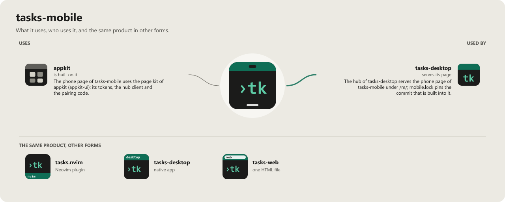

# tasks-mobile

The phone app of [tasks-desktop](https://github.com/WKDSteve/tasks-desktop): capture a task on the way and go through
the vault, as an installable web app (PWA). Android first; iOS later.

It is a client and nothing more. The rules of the tasks are the engine's ([tasks.nvim](https://github.com/WKDSteve/tasks.nvim)),
reached through the hub of tasks-desktop on your PC; this page shows what the hub sends and sends operations
(`tasks-export/1`, `tasks-ops/1`). There is no cloud and no second copy of the rules.

## State

The hub of tasks-desktop serves this page under `/m/` from its rolling build
[`latest`](https://github.com/WKDSteve/tasks-desktop/releases/tag/latest) on (the commit of tasks-mobile it carries is
pinned in its `mobile.lock`); the way in is an SSH tunnel to the PC ([docs/USAGE.md](docs/USAGE.md)). Not checked on a
real phone yet. What the hub still has to do (filter by class for the phone, devices, Tailscale) is in
[docs/HUB.md](docs/HUB.md). For working on the page, `pnpm dev` runs it on a synthetic vault in a browser.

What is there:

- **Today**, where the app starts: what the engine would take next, the tasks that wait for an answer, the tasks whose
  due or reminder day has come, and the engine's counts per status over the areas shown here (it says when areas are
  missing). Offline it shows the kept copy with its time.
- **List** of the open tasks of the areas that may be shown on a phone, with a filter by area and words.
- **Capture**: title, area, one sentence of context, and up to three attachments: a **photo** (camera or gallery) or a
  **voice note** (recorded in the app, heard before it is sent; up to 25 MB each). The files are sent to the task once
  the engine made it. Also as a **share target** on Android: share a link or a text from another app to tasks, and the
  form is filled (it never creates a task by itself).
- **A task**: its text, its status (set it), its open questions (answer them), and finishing it after the engine said
  what that sets off (a plan it closes, tasks it frees).
- **Offline**: the last list stays readable; what you create or change offline waits in a queue and is sent when the
  hub is reached again. Nothing is shown as done before the engine said so; a change the file moved on from is a
  conflict you see, never an overwrite. The queue is the one of appkit (`appkit-ui/queue`); only the files of a new
  task, sent after the engine made it, are added here (`src/lib/queue.ts`).
- **An export file** instead of a connection: `tasks-hub phone export <file>` on the PC writes the released areas to a
  file; the page opens it read only, refuses it whole when it holds an area of another class than `public` or
  `internal` (`phoneExport` in `src/lib/parse.ts`), and says that creating and changing need the PC.
- **Notifications** (turned on under Waiting): a reminder that is due and a task that waits for your decision. The
  notification names only its kind, never the title or text of a task; tapping it opens the task, which loads over the
  paired way then. The browser asks for the permission only on the button. Needs a hub that sends Web Push
  (`appkit-hub::push`, kinds `remind` and `decision`).

What is not there (on purpose): editing the body, plans, anything with AI, deleting.

## Data classes

Only areas of the class `public` or `internal` (from the vault's `areas.json`, as the hub reads it) are shown on the
phone or kept on it. An area without a class, or `private`, stays on the PC; the page says how many areas it leaves
out. See [SECURITY.md](SECURITY.md).

## Use it (once the hub serves it)

[docs/USAGE.md](docs/USAGE.md): the SSH tunnel from the phone to the PC, pairing, installing the app on Android.

## Build and test

Needs Node 24 or newer, pnpm 10, and Chrome for the browser tests.

```
pnpm install --frozen-lockfile
pnpm check            # svelte-check and tsc
pnpm test             # unit tests (vitest)
pnpm e2e              # both builds, then the page in Chrome with a phone's screen, under the hub's CSP
python tools/check-control-chars.py
```

- `pnpm build` makes `dist/`, the page the hub will serve. It speaks to the hub only.
- `pnpm build:fake` / `pnpm dev` make the same page on a synthetic vault in memory (`src/lib/fakeSource.ts`), marked
  "Test data" on the page. It is never served to a phone; `e2e/bundle.spec.ts` checks that `dist/` holds none of it.

Rules: the ruleset `mobile` of [rules-vault](https://github.com/WKDSteve/rules-vault) (`rulesets/mobile`), together
with the web rules of `native`.

## License

MIT, see [LICENSE](LICENSE).

<!-- connections:begin (written by the app-icons tool of the workshop; change integrations.json there, not this block) -->
## Connections



**Uses**

- [appkit](https://github.com/WKDSteve/appkit): The phone page of tasks-mobile uses the page kit of appkit (`appkit-ui`): its tokens, the hub client and the pairing code. ([picture](assets/graphs/pair/tasks-mobile--appkit.png))

**Used by**

- [tasks-desktop](https://github.com/WKDSteve/tasks-desktop): The hub of tasks-desktop serves the phone page of tasks-mobile under `/m/`; `mobile.lock` pins the commit that is built into it. ([picture](assets/graphs/pair/tasks-desktop--tasks-mobile.png))
<!-- connections:end -->
